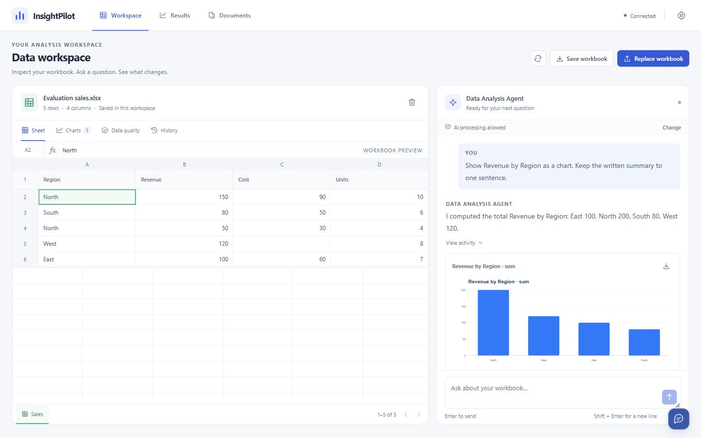
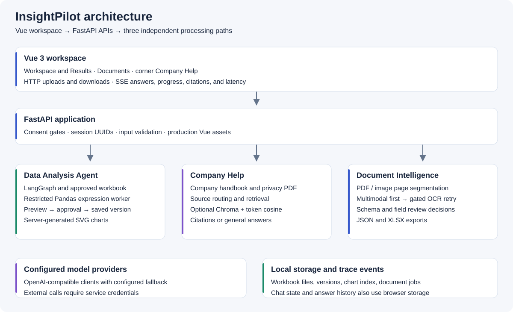

# InsightPilot

A document and data workspace built with Vue 3, FastAPI, and LangGraph.
Inspect an Excel workbook beside an AI analyst, approve changes before saving,
ask questions about company documents, and review OCR-extracted fields.



*Captured from the running frontend using a synthetic five-row workbook. The
chart and answer were generated from that workbook.*

## Capabilities

- Inspect and manage saved Excel workbooks in an Excel-style grid.
- Analyze data, generate charts, and approve column changes with the agent.
- Browse saved answers, charts, and profile runs in Results.
- Ask general or company-document questions through Company Help.
- Extract document fields using multimodal images and a gated OCR retry.

## Architecture and pipelines



The Vue frontend sends HTTP requests and consumes server-sent events from one
FastAPI application. Data analysis, company assistance, and document extraction
have separate APIs and processing paths. OpenAI-compatible model clients use
the configured provider order.

- Workbook analysis uses a restricted expression evaluator in an isolated child
  process. Column changes follow a separate preview, approval, revision-check,
  and workbook-version flow. Charts are rendered on the server from real data.
- Company retrieval combines token-count cosine similarity with Chroma vector
  scores when Chroma is available. The active sources are the Nimbus Orchard
  handbook and privacy policy. General answers use a separate source-free path.
- Document extraction sends the image directly to the multimodal model for
  classification and fields. A failed or uncertain result gets one OCR-assisted
  retry, using Azure Document Intelligence, Google Document AI, then vision OCR.
  Schema validation, handwriting adjustments, and confidence thresholds determine
  review flags. Conflicting attempts require human review.

[Workbook pipeline](docs/images/spreadsheet-agent.svg) ·
[Document pipeline](docs/images/document-processing.svg)

## Run locally

Use Python 3.12 and Node.js 18 or newer. Run these commands from the repository
root in Linux or WSL.

```bash
python3.12 -m venv .venv
source .venv/bin/activate
pip install -r backend/requirements.txt
cp .env.example .env
```

Set the credentials and model ID for at least one provider in `.env`. The
available provider names are `openai`, `azure`, and `gemini`. Dedicated OCR
credentials are optional when the configured model supports image input.
Tavily credentials enable the analyst's external definition lookup.

Start the backend in one terminal.

```bash
source .venv/bin/activate
cd backend
uvicorn main:app --host 0.0.0.0 --port 8000
```

Start the frontend in another terminal.

```bash
cd frontend
npm ci
npm run dev -- --host 0.0.0.0 --port 5173
```

Open [the workspace](http://localhost:5173). The backend also serves the built
frontend at [port 8000](http://localhost:8000) after `npm run build` in
`frontend`. API documentation is available at [Swagger UI](http://localhost:8000/docs).

[Provider setup](RUN.md) · [Frontend development](frontend/README.md)

## Evaluation

Measured on 6 November 2026, the module smoke checks and parameter study use synthetic data and
the checked-in company handbook. The retrieval study uses **8 development
questions and 6 held-out questions**. Baseline and selected answers are generated
twice per held-out question. The selected configuration is chosen using
development retrieval F1 before held-out scoring.

[Module results](backend/evals/evaluation_results.json) ·
[Parameter results and claim traces](backend/evals/parameter_study_results.json) ·
[Metric definitions and reproduction](docs/EVALUATION.md)

### 1. Groundedness

Faithfulness is judge-assisted entailment of fixed answer sentences against
retrieved evidence. The grader uses the configured model provider family, with
stable sentence/source IDs and literal supporting-quotation checks. Coverage and
support are scored separately. These are benchmark scores with small samples.

| Metric | Baseline k=5 | F1 candidate k=1 | Definition |
| --- | --- | --- | --- |
| Citation coverage | 44.0% (11/25) | 25.0% (8/32) | Attributed factual sentences / factual sentences |
| Faithfulness | 44.0% (11/25) | 28.1% (9/32) | Evidence-supported factual sentences / factual sentences |
| Citation precision | 100.0% (11/11) | 87.5% (7/8) | Supported attributed sentences / attributed sentences |
| Reference-fact recall | 71.4% (10/14) | 42.9% (6/14) | Correctly conveyed reference facts / expected facts |
| Valid answer grades | 12/12 | 12/12 | Invalid judge output is reported separately |

### 2. Module metrics

Precision, recall, and F1 are shown in that order. Retrieval scores use unique
source sections among returned chunks. Extraction scores use required schema
fields matched to labeled printed fixtures.

| Evaluation | Result | Evidence and scope |
| --- | --- | --- |
| Held-out retrieval P / R / F1 | Baseline 31.8% / 100.0% / 48.3%; selected 83.3% / 71.4% / 76.9% | 6 held-out questions and 7 relevant source sections |
| Data Analysis Agent | 6/6 application checks; 4/4 direct calculations; 5/5 restricted operations rejected | Five-row workbook, exact numeric references, approval flow, and SVG download |
| Company assistance | 7/7 behavior checks | Handbook facts, general answers, workbook handoff, injection rejection, unsupported policy |
| Document extraction | P/R/F1 100% / 100% / 100%; field CER 0.000; classification 2/2; exports 4/4 | Eight fields on two clear printed pages; multimodal-first processing |
| Regression tests | 151 backend tests + 3 subtests; 10 frontend tests | Separate code-contract and regression coverage |

The 7/7 assistance result covers the earlier, narrower behavior cases. The new
held-out questions exposed company-source routing gaps, including Sprout pricing
and non-profit discounts. Some answers took the general-answer path despite
relevant handbook evidence being available. These responses remain in the
groundedness scores and explain part of the reduced reference-fact recall.

### 3. One-factor parameter experiments

Each alternative changes one factor from k=5, chunk=1200 characters,
overlap=180 characters, and score=0.15. Values and development F1 scores align
left to right. The final row records the selected configuration and the trial
that combined individual winners.

| Factor | Values tested | Development F1 | Choice in this study |
| --- | --- | --- | --- |
| Top-k chunks | 5, 1, 3 | 0.500, 0.824, 0.692 | 1 |
| Chunk characters | 1200, 800, 1600 | 0.500, 0.529, 0.383 | 800 |
| Overlap characters | 180, 90, 270 | 0.500, 0.500, 0.462 | 180 |
| Minimum score | 0.15, 0.35, 0.55 | 0.500, 0.500, 0.500 | 0.15 |
| Best tested retrieval configuration | k=1, chunk=1200, overlap=180, score=0.15 | 0.824; combined trial 0.824 | Earlier baseline settings break exact ties |

The combined trial used k=1 and chunk=800, with overlap=180 and score=0.15. It
tied the development F1 of k=1 with chunk=1200, so the earlier configuration won.
The k=1 candidate improves retrieval F1 but loses held-out evidence recall and
answer reference-fact recall. **Production remains at k=5**. This is
the best tested retrieval-F1 configuration for this split. No overall model or
production-wide optimum is claimed.

Other controls remain fixed. Analyst temperature is 0.1, assistance temperature
is 0.0, field review threshold is 0.85, and handwriting penalty is 0.20. The
multimodal model uses provider-default sampling and one OCR-assisted retry.
No temperature sweep, weight fine-tuning, or confidence calibration was run.

The live extraction run correctly skipped OCR on both validated image results.
In the separate OCR check, Azure DNS resolution failed and Google Document AI
billing was disabled. Vision OCR fallback completed. Handwriting and degraded
scan accuracy remain unmeasured. Sentence grading uses a model judge, with its
own entailment and factual-sentence selection limitations.

## Reproduce the checks

```bash
source .venv/bin/activate
pip install -r backend/requirements-dev.txt
cd backend
pytest -q
python -m evals.run_all_evaluations
python -m evals.run_all_evaluations --live
python -m evals.parameter_study --live --repetitions 2
```

The default evaluation runs local sandbox and retrieval checks. `--live` also
requires the backend on port 8000 and sends generated fixtures and reference
questions to configured services. Live tests use new session UUIDs and remove
their workbook sessions afterward. OCR output jobs remain available for inspection.
Chroma may download its default embedding model on first use.

Run the frontend checks from a separate terminal at the repository root.

```bash
cd frontend
npm test
npm run build
```

The final regression run passed **151 backend tests and 3 subtests**. The
frontend suite passed **10 tests**, and the production build succeeded.

## Storage and current limits

Workbook files, versions, chart metadata, and OCR job outputs are local to the
backend. Workbook and answer state also use browser storage scoped to a session.
Conversation checkpoints, pending previews, and the company evidence index are
process-local. A backend restart invalidates pending approvals.

The application currently uses session UUIDs without authenticated user or
tenant accounts. The expression interpreter restricts supported operations and
uses a child process, while sharing the backend host's operating-system context.
The current evaluation covers clear synthetic inputs and selected adversarial
requests. Larger held-out datasets, noisy scans, handwriting, concurrency, and
confidence calibration need separate validation.

## Repository layout

```text
backend/
  main.py                    FastAPI application and frontend serving
  excel_agent/               Workbook analysis, restricted execution, mutations
  document_assistance/       Company knowledge retrieval and general assistance
  document_intelligence/     OCR, extraction, validation, and exports
  datapilot/                 Shared providers, configuration, guardrails, latency
  evals/                     Reproducible runner and measured results
  tests/                     Backend regression tests
frontend/src/                Vue screens, components, API client, design tokens
docs/                        Architecture, pipelines, evaluation methods
```
